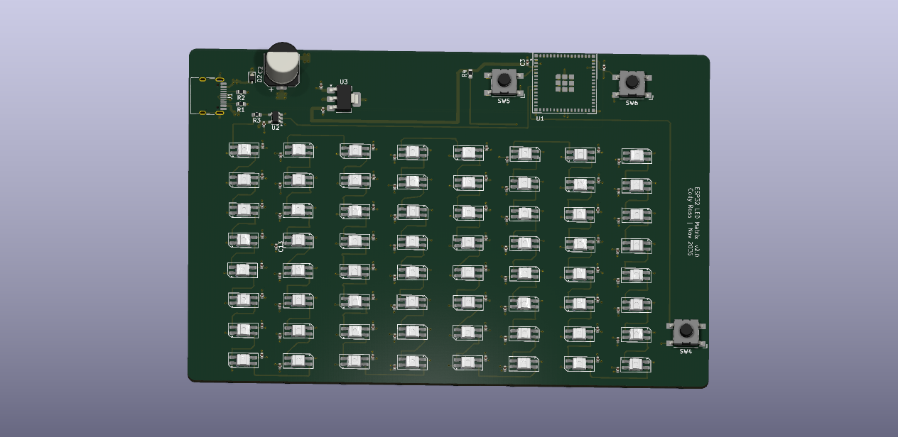

# ESP32 LED Matrix

Custom ESP32-S3 PCB with an 8x8 addressable LED matrix and push buttons, designed in KiCad and assembled by JLCPCB. Built to play simple one-button games like the Chrome Dino game.

## Hardware
- ESP32-S3-MINI-1 (N8) microcontroller
- 64 SK6812MINI-E reverse-mount RGB LEDs
- USB-C power and programming, with 5.1k CC resistors
- SN74AHCT1G125 level shifter (3.3V to 5V LED data)
- AP7361C 3.3V LDO, SD05 TVS protection, 1000µF bulk cap
- 3 tactile buttons

## Repo layout
- `hardware/` KiCad project (schematic, PCB, libraries)
- `hardware/fab/` Gerbers, BOM, and CPL files for JLCPCB
- `firmware/` ESP32 code (coming soon)
- `docs/` Schematic PDF and images

## Status
Rev A boards ordered November 2026. Firmware and photos to come.
